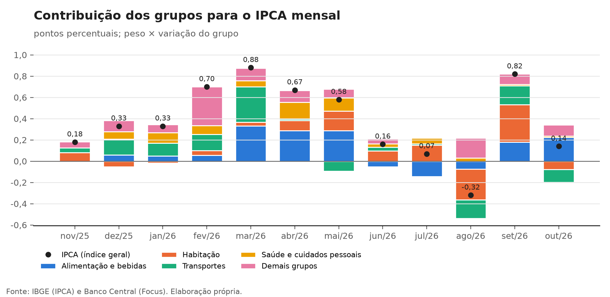
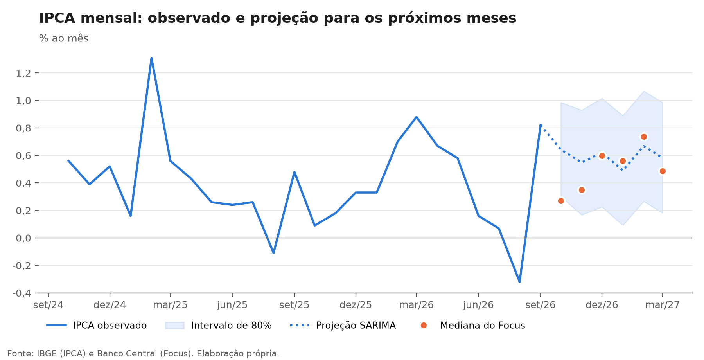
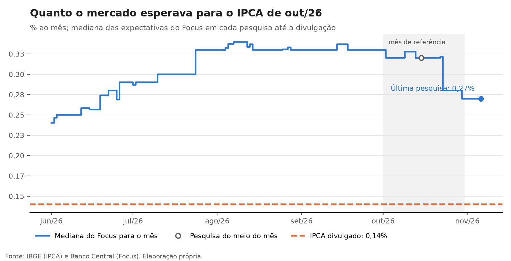
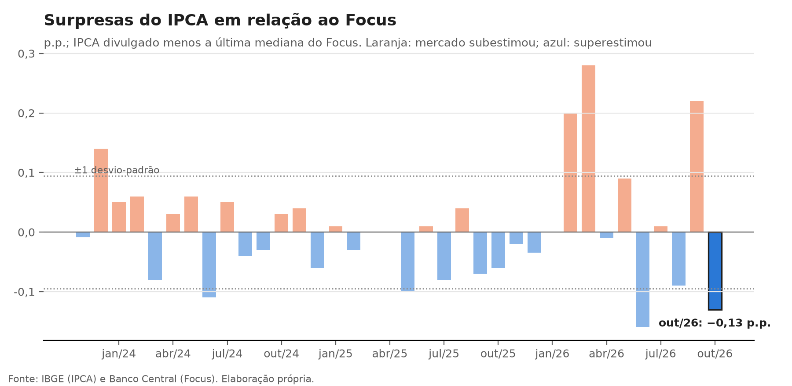
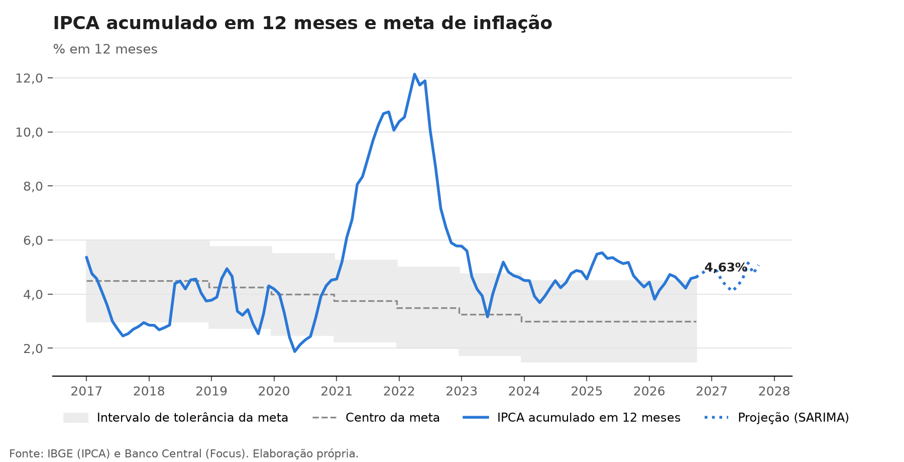

# Monitor de inflação: IPCA de out/26

*Atualizado automaticamente após a divulgação do IPCA pelo IBGE.*

## Destaques

- **IPCA de out/26: 0,14%.** A mediana do Focus coletada no meio do mês esperava 0,32%: surpresa de -0,18 p.p.
- **Acumulado em 12 meses: 4,63%**, para uma meta de 3,0% e teto de 4,5% (acima do teto).
- **Acumulado no ano: 4,10%.**
- **Inflação projetada para os próximos 12 meses (SARIMA, até out/27): 5,07%.**

## Leitura

*Leitura referente ao IPCA de setembro de 2026.*

O IPCA subiu 0,82% em setembro, puxado por três grupos que somaram 0,71 p.p., quase 90% do índice. Habitação liderou, com 0,35 p.p.: a energia elétrica subiu 7,98% com o fim do Bônus de Itaipu e foi o maior impacto individual do mês. Alimentação e bebidas contribuiu com 0,18 p.p., com a alimentação no domicílio em alta de 0,96%, concentrada em tomate, batata, cebola e arroz, enquanto o frango caiu. Transportes somou outros 0,18 p.p., com passagens aéreas (9,66%) e combustíveis (1,41%, com etanol a 3,16% e gasolina a 1,21%).

Fora desses três grupos, a alta foi moderada: os outros seis somaram 0,11 p.p., com Saúde e cuidados pessoais (0,08%) e Educação (0,04%) praticamente estáveis. O resultado do mês é, portanto, concentrado em preços administrados, alimentos in natura e itens voláteis, e não um avanço disseminado.

Com o resultado, o acumulado em 12 meses foi a 4,58%, acima do teto de 4,5%, e o acumulado no ano a 3,95%. O índice superou em 0,32 p.p. a mediana do Focus coletada no meio do mês (0,50%). Para outubro, o Focus espera 0,32%, e o SARIMA, 0,64%: o modelo univariado tende a projetar a alta de setembro para frente, sem distinguir o choque de energia da tendência, o que reforça o próximo passo do projeto, incluir o IPCA-15 e o calendário de reajustes.

*Fonte dos itens: IBGE, divulgação do IPCA de setembro de 2026.*

## Contribuições por grupo

| Grupo | out/26 (p.p.) | Soma dos últimos 12 meses (p.p.) |
|---|---:|---:|
| Alimentação e bebidas | 0,22 | 1,20 |
| Habitação | -0,08 | 0,61 |
| Transportes | -0,12 | 0,65 |
| Saúde e cuidados pessoais | 0,01 | 0,72 |
| Demais grupos | 0,11 | 1,35 |

## Projeção

| Mês | SARIMA (%) | Intervalo de 80% | Focus, mediana (%) | Acumulado em 12 meses, SARIMA (%) |
|---|---:|---:|---:|---:|
| nov/26 | 0,30 | -0,04 a 0,65 | 0,35 | 4,76 |
| dez/26 | 0,46 | 0,07 a 0,84 | 0,60 | 4,89 |
| jan/27 | 0,39 | -0,01 a 0,78 | 0,57 | 4,95 |
| fev/27 | 0,60 | 0,20 a 1,00 | 0,75 | 4,84 |
| mar/27 | 0,54 | 0,14 a 0,94 | 0,49 | 4,49 |
| abr/27 | 0,46 | 0,06 a 0,87 | 0,48 | 4,28 |

### Desempenho fora da amostra

Previsões um passo à frente nos últimos 36 meses, em pontos percentuais. A mediana do Focus é a coletada na metade do mês de referência, quando o IPCA do mês anterior já é conhecido, o mesmo conjunto de informação dos modelos.

| Modelo | RMSE | MAE | Viés |
|---|---:|---:|---:|
| Mediana do Focus | 0,157 | 0,119 | -0,019 |
| Sazonal simples | 0,260 | 0,210 | -0,018 |
| SARIMA | 0,313 | 0,231 | 0,031 |

## Precisão do Focus

- **Surpresa de out/26: -0,13 p.p.** em relação à última pesquisa disponível antes da divulgação (0,27%), e -0,18 p.p. em relação à do meio do mês.
- Em módulo, é a 6ª maior surpresa dos últimos 36 meses. O desvio-padrão das surpresas no período é de 0,09 p.p., e o viés médio, de 0,01 p.p.
- O mercado superestimou o IPCA neste mês, invertendo o sinal do erro anterior.

